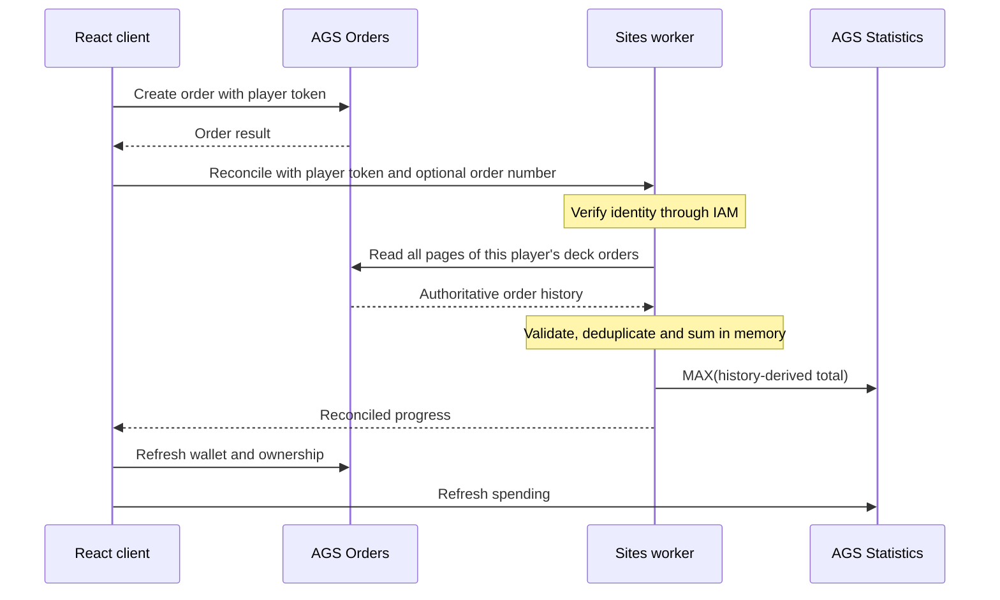

# Building a Choice-Based Battle Pass with AGS

> For configuration steps, code examples, and an illustrated walkthrough, read the [developer tutorial](battle-pass-tutorial.md).

A player has 60 points. They buy a radio charm for 10 and a pack appearance for 30. That leaves 20 points in their wallet—and opens the next tier of rewards.

They did not collect everything in the first tier. They chose what they wanted, and their spending unlocked more choices.

That is the mechanic this tutorial builds. Inspired by reward selection in ARC Raiders' Raider Deck, **Signal Range** is an original three-tier collection with nine rewards. Its prices, thresholds and artwork are tutorial placeholders, rather than a recreation of the game's exact economy.

The implementation uses React for the interface, AccelByte Gaming Services (AGS) for purchases and progression data, and a Sites worker for trusted spending accounting. The interesting part is deciding where each rule belongs—and keeping progress correct when a purchase succeeds but the next request does not.

## Start with three separate values

The deck tracks available points, cumulative spending and ownership independently.

| Value | What it answers | Example after two purchases |
| --- | --- | --- |
| Wallet balance | What can I afford now? | 20 points |
| Deck spending | Which tiers can I access? | 40 points |
| Entitlements | Which rewards do I own? | Field radio and Ridge pack |

The tier thresholds are 0, 40 and 100 points spent. Reaching a threshold gives access to that tier's cards. It does not grant those cards or deduct another fee.

This distinction also explains why wallet balance cannot serve as progression. Adding points should increase purchasing power without unlocking a tier. Spending those points on the configured deck rewards is what advances this collection.

## Where does native Season Pass fit?

AGS Season Pass supports manual reward claims. Describing it as a system that always grants rewards automatically would miss an existing capability.

The difference here is the payment rule. A player pays a separate point price for each selected reward, and cumulative spending controls access to subsequent tiers. This implementation uses Commerce for per-reward purchases and Statistics for cumulative spending. Granting currency as a reward is a different operation from charging it for a selected item.

There is a possible hybrid: sell the cards through Commerce, turn verified spending into Season Pass XP, and gate items through season-tier requirements. That still needs trusted purchase accounting and synchronization.

For this deck, a dedicated spending statistic maps directly to the rule. AGS Purchasing Requirements can compare that statistic with a threshold when the player purchases an item.

See the official guides for [Season Pass configuration](https://docs.accelbyte.io/gaming-services/modules/online/season-pass/configuring-season-pass/) and [Purchasing Requirements](https://docs.accelbyte.io/gaming-services/modules/online/wallets-payments/how-to/configure-purchasing-requirements/).

## Configure the economy before wiring the interface

The prototype uses the following configuration:

| Component | Configuration |
| --- | --- |
| Currency | RDP, virtual currency with zero decimal places |
| Rewards | Nine INGAMEITEM catalog items with DURABLE entitlements |
| Prices | 10, 20 and 30 points in each tier |
| Purchase limits | Quantity one; maxCountPerUser of one |
| Progress | A server-written, player-readable statistic dedicated to this deck |
| Tier requirements | No spending requirement for tier one; >= 40 for tier two; >= 100 for tier three |
| Purchase history | AGS Orders; no separate transaction store |

In a test namespace, create the currency and catalog items, then create the spending statistic. This fixture uses a default/minimum of zero and a maximum of 180—the cost of all nine cards. Its statistic is configured for increasing progress and cannot be written by a player.

Attach a StatisticCodePredicate purchasing requirement to each tier-two and tier-three item, then publish the configured store. The statistic predicate uses `code`, `comparison: isGreaterThanOrEqual`, and the singular `value` field containing the threshold as a string.

Maintain the corresponding item IDs, prices and thresholds in the client configuration and the worker's trusted deck definition. The worker definition identifies which items belong to this particular season; it does not accept a season label supplied by the browser as proof.

For authentication, the test browser signs in a disposable Device ID player through a Public client and uses the resulting player token for purchases. The worker uses a separate Confidential client, with its secret stored only in server configuration. Device ID sign-in here is a test convenience, not a production account design.

For order reconciliation, configure the worker client with these permission groups:

| Module / group | Actions |
| --- | --- |
| m_platform_store / g_order | READ |
| m_statistics / g_user_statistics_value | CREATE, READ, UPDATE |

These permissions support order reads and spending-statistic writes. Their access is namespace-wide, so restrict every operation to the verified player and configured deck. This reconciliation worker does not need Cloud Save, wallet-credit, or entitlement-fulfillment permission.

The prototype starts with operator-funded points. Awarding currency from trusted gameplay completion is outside this implementation.

## Let AGS complete the purchase

The refreshed interface uses First contact, Perimeter, and Last signal tier tabs, an owned-only Collection view, and inspectable reward details before purchase confirmation. Locked cards can be previewed; their purchase confirmation remains disabled. The available wallet, season spending, and collection count stay separate.

The React client loads catalog data, wallet balance, entitlements and spending. It uses those values to display prices, owned cards and tier access. Those checks make the interface useful, while native purchase requirements enforce eligibility on the AGS side.

After confirmation, the client creates an order using the player's token. This excerpt comes from [ags-deck-client.ts](../../../prototype/lib/ags-deck-client.ts); `request` is the project's HTTP helper, not an AGS SDK method:

```ts
const created = await request<LiveOrder>(
  s,
  `${platform}/users/${encodeURIComponent(s.userId)}/orders`,
  'Create order',
  {
    itemId: DECK_ITEMS[rewardId],
    quantity: 1,
    currencyCode: AGS.currency,
    price: reward.cost,
    discountedPrice: reward.cost,
    region: 'US',
    language: 'en',
  },
);
```

AGS handles the purchase payment and fulfillment. There is no second wallet debit or independent reward grant in the worker.

The client checks the returned order and refreshes authoritative state. It keeps fulfillment and progression separate: owning the reward does not prove that the spending statistic has already caught up.

The worker's reconciliation endpoint accepts only an optional order number. It verifies the player token through IAM and derives the user identity from that verification. A browser cannot submit “add 30 points” or choose another player to update. Even an order-number hint must be read and checked against the verified player and deck.

## Turn fulfilled orders into durable spending

A straightforward implementation might add the price to a statistic immediately after creating an order. Two problems appear quickly: order creation does not by itself establish fulfillment, and repeating the follow-up request can add the same spending twice.

Instead, the worker reads authoritative order history for the configured deck items. It validates each candidate before treating it as a contribution.

In this implementation, an accepted receipt must belong to the verified player and namespace, reference a configured deck item, and have FULFILLED status. Quantity must be one. The currency must be the expected zero-decimal virtual currency. The payment fields and item snapshot must match the fixed-price durable-item contract.

The code reads the order's `discountedPrice` and requires it to agree with the configured price and the other validated payment fields. It also requires zero deductions, taxes and payment fees. This deliberately supports this fixed-price economy; it is not a general accounting formula for discounted or mixed-payment orders.

AGS already stores the transaction history. We do not copy that history into Cloud Save. On each reconciliation, the worker deduplicates fulfilled orders by order number in memory and sums their validated contributions for this deck.

The distinction matters: Entitlements answers whether the player owns a reward; Orders supplies the transaction and payment information used to calculate spending. An owned item alone is not evidence of how much was paid or which deck should receive progress.



The order queries must finish before the worker publishes any total. A failed page or exceeded paging bound produces an error, rather than treating a partial response as the complete history. A direct order-number lookup can supplement indexed history immediately after purchase, but it must pass the same identity and deck checks.

### Deduplicate within the history response

The [order-spending function](../../../prototype/lib/order-spending.ts) uses an in-memory map keyed by order number. Repeated appearances of the same order contribute once. Conflicting data for one order number is rejected, as are two distinct fulfilled purchases of the same one-time reward.

After validation and deduplication, the calculation is:

```ts
const total = [...contributions.values()]
  .reduce((sum, order) => sum + order.paid, 0);
```

Nothing from that map is stored separately. A later request performs the same calculation from AGS Orders.

### Publish an absolute total

The worker updates Statistics with MAX:

```ts
const update = () => ags<{ currentValue: number }>(stat, 'PUT', {
  updateStrategy: 'MAX',
  value: total,
});
```

Suppose one request derives 40 and another derives 60, but their updates arrive in reverse order. MAX keeps 60. Publishing 60 again also leaves 60, instead of adding another 60.

This is why the worker does not need a second persistent record of which orders were already counted. It publishes the total derived from history, not an increment for each callback.

There is an important scope assumption: the required order history must remain available. Pagination confirms that the worker consumed the returned pages; it does not prove indefinite retention or instantaneous indexing. MAX preserves spending already projected when a later query sees an older snapshot, but cannot reconstruct an unprojected order that is no longer available. Confirm order-history retention for your production season's lifecycle.

## Recover without repeating the purchase

Consider a fulfilled purchase whose callback never reaches the worker. The wallet has been charged and ownership granted, but deck spending is stale.

The worker can recover because it reads order history, rather than relying exclusively on the supplied order number. The client reconciles on connection, before and after purchase, when returning to the page or coming back online, and through the visible retry control.

For example, buying Pulse reader for 10 after reaching 40 spent should bring the total to 50. If the callback is lost, reconciliation discovers the fulfilled order and publishes that total.

Now consider a successful order-history read followed by a failed Statistics update. The next request rereads Orders and republishes the absolute total. If the stat update succeeded but its response was lost, repeating MAX still has no additional spending effect.

The automated tests exercise these recovery cases without a persistent receipt ledger.

An ambiguous order-create response needs a different precaution. If the request times out, the client does not know whether AGS accepted it. It saves a submission marker containing the reward and, when available, the order number. The marker survives reload, but carries no authority over money or progress. The client resolves it through order history and ownership rather than blindly issuing the same POST again.

If the outcome cannot be established, the current prototype keeps purchasing blocked for review. It does not promise automatic resolution of every ambiguous failure or a general exactly-once order API.

This also defines the Sites worker's limit: recovery requires a request. If a player never returns, a fulfilled order may remain absent from the spending projection until an authorized reconciliation runs. An Extend event handler could provide a background trigger, but no Extend handler was deployed in this implementation.

## Check the outcome against the services

Fund a disposable player with 60 points for the two-reward walkthrough. To test all nine rewards, add another 120 points through your authorized test setup. All nine rewards total 180.

| Check | Expected result |
| --- | --- |
| Buy Field radio and Ridge pack | 20 available, 40 spent, two owned; Tier 2 accessible |
| Add points without purchasing | Wallet increases; spending and ownership stay unchanged |
| Reconcile repeatedly or concurrently | The same orders produce the same spending total |
| Lose a callback or Statistics response | Reconciliation republishes the total without repeating payment |
| Reach 100 spent while leaving Pathfinder unowned | Tier 3 is accessible without completing Tier 1 |
| Buy all nine rewards with 180 total funding | Zero balance, 180 spent, nine fulfilled orders and nine owned rewards |

Check native purchasing requirements at 39/40 and 99/100 spent. A request below its tier threshold must be rejected, even when the UI is bypassed. Also test owned and unaffordable rewards, account switching, and expired tokens.

Run the automated tests and service acceptance checks in your test namespace.

## What this implementation leaves for a larger game

Signal Range is deliberately bounded: nine permanent rewards, fixed prices, a dedicated deck identity and no refunds. Its bounded order-history scan fits that scope. A repeatable economy needs a different query and retention strategy; this scan should not be treated as a demonstrated large-scale solution.

MAX also assumes progress never decreases. Refunds and retroactive corrections require another policy. Gameplay currency awards, production identity, operational monitoring and unattended processing remain separate work.

Configure Commerce CORS for the browser origins that call AGS directly. A same-origin worker bridge can forward approved requests with the player token.

To inspect the implementation, start with the [prototype README](../../../prototype/README.md), the [client adapter](../../../prototype/lib/ags-deck-client.ts), the [worker reconciler](../../../prototype/lib/server/reconcile-deck.ts) and the [order-spending rules](../../../prototype/lib/order-spending.ts). The README describes configuration and the test/build commands. Use your own test namespace and item mapping.

The resulting division is straightforward: AGS handles purchasing, ownership and tier eligibility. The worker derives the correct deck total from the transactions AGS already stores and republishes it safely when progress needs repair. That is the reusable part of this choice-based battle pass.
