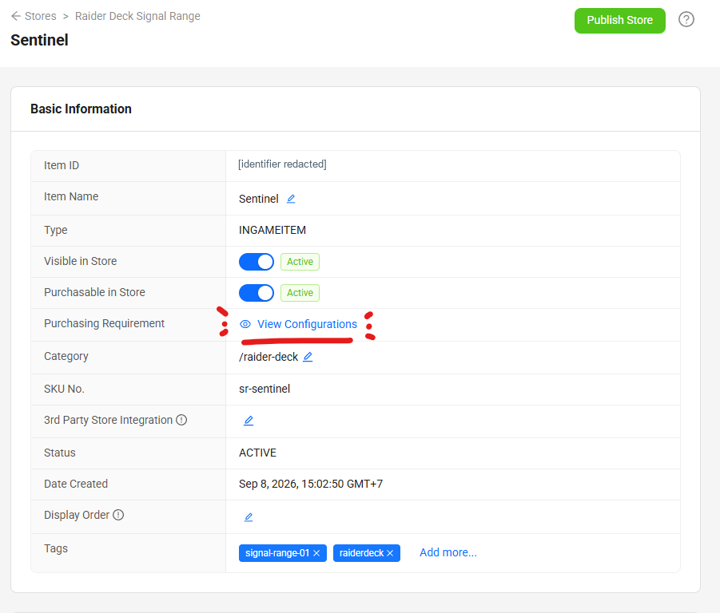
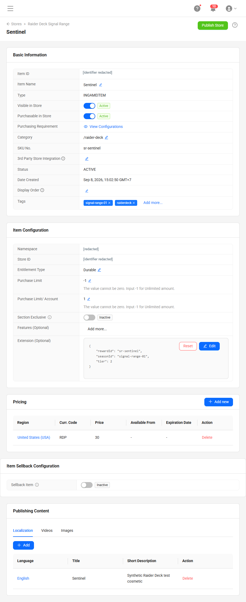
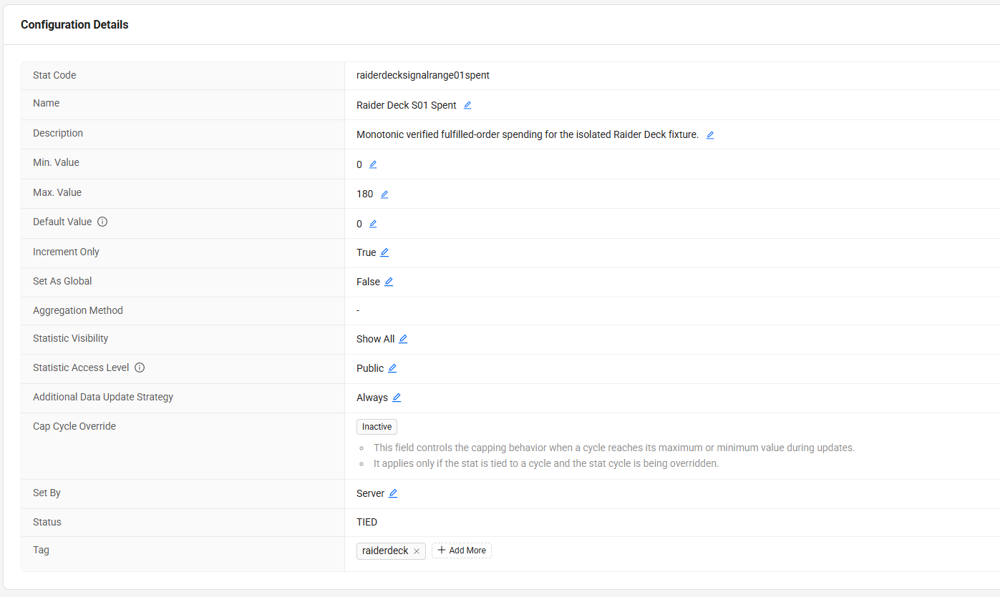
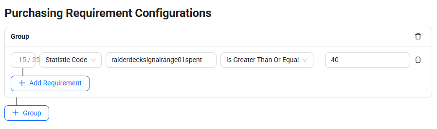
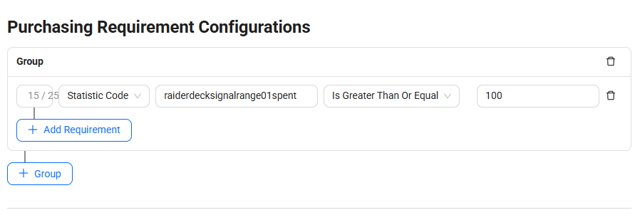
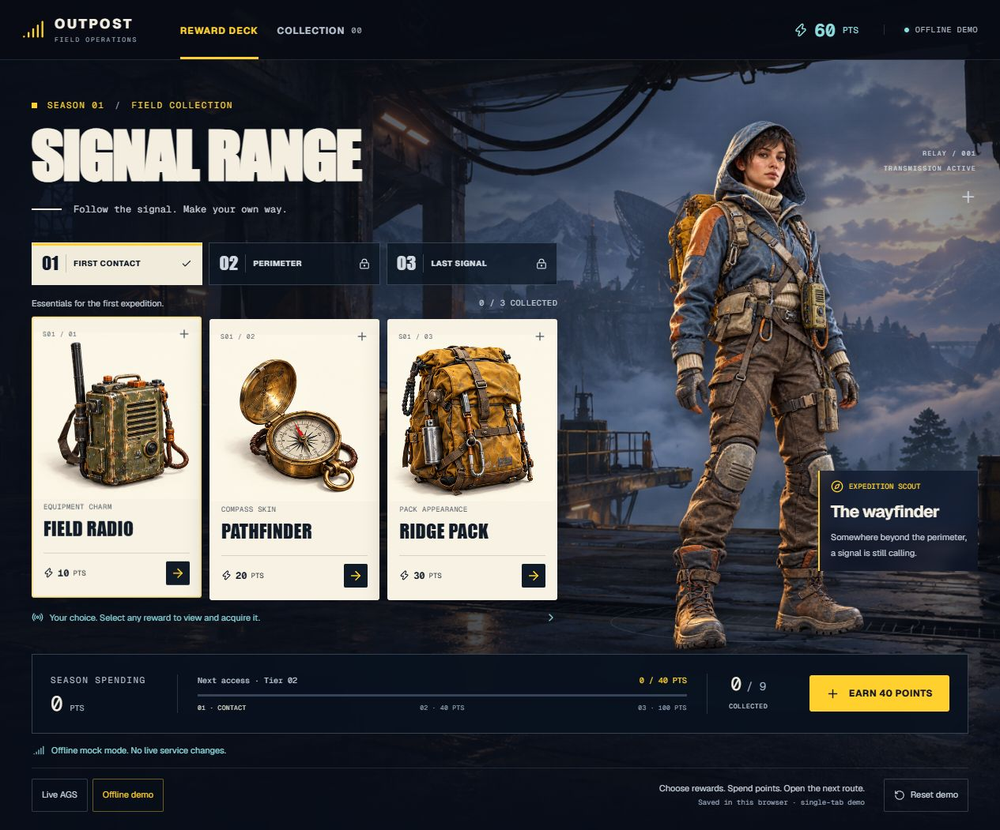
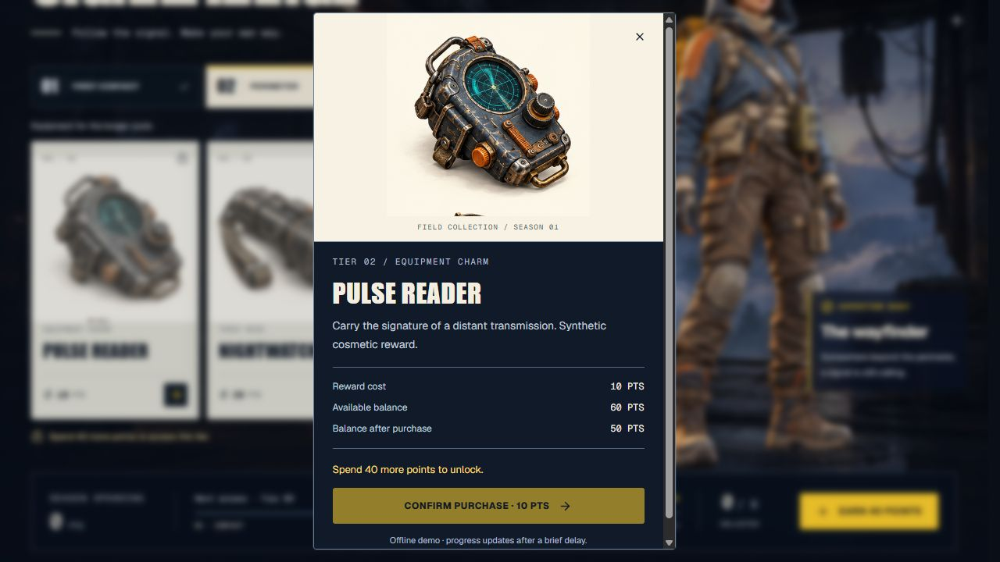
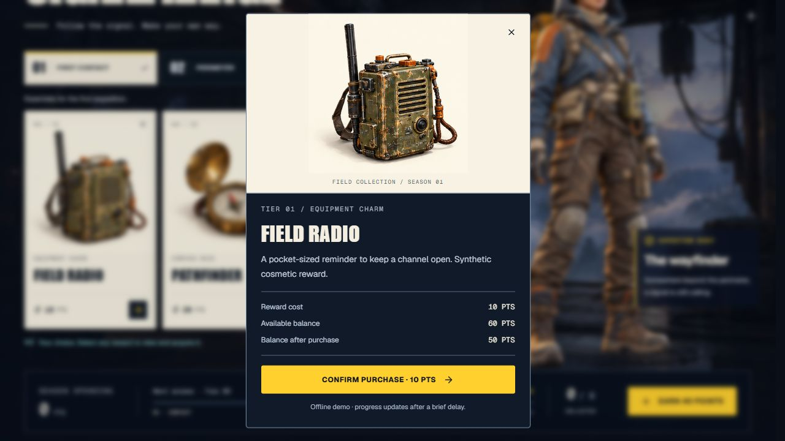
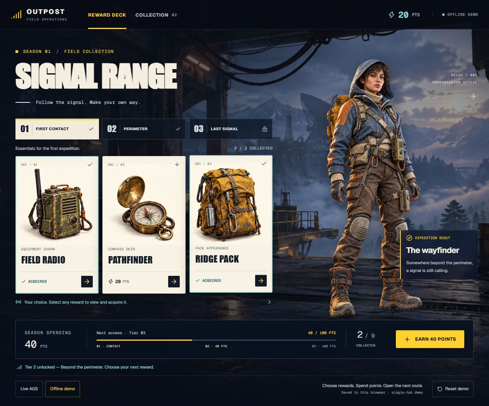
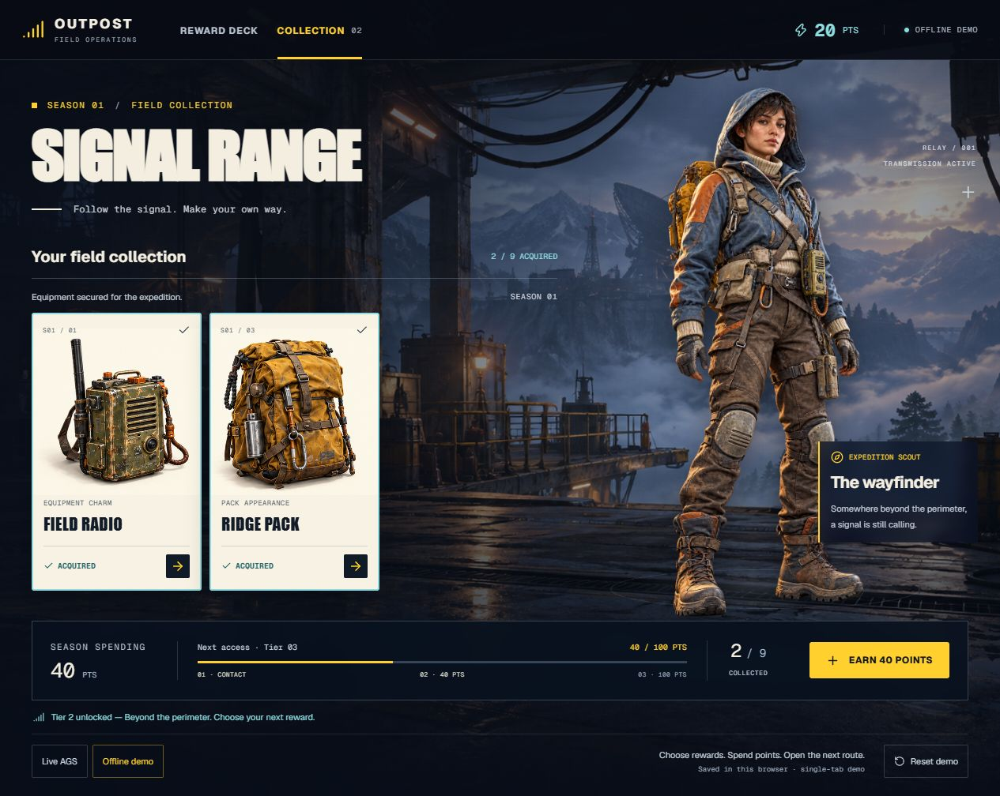

# Build a Choice-Based Battle Pass with AccelByte Gaming Services

*A developer tutorial for reward selection, virtual-currency purchases, and spending-based tier access.*

> Read the browser-friendly [HTML guide](../../../battle-pass-tutorial.html), with code examples and configuration screenshots.

Imagine a battle pass where players decide which rewards to buy. A player chooses a radio charm, skips a compass skin, and saves for a backpack appearance. Their purchases open the next tier, where they can make another choice.

This tutorial breaks down how to support that experience with AccelByte Gaming Services (AGS). AGS supplies player identity, a virtual-currency wallet, catalog purchases, ownership, and purchase conditions. A small trusted backend derives cumulative deck spending from fulfilled orders and updates the value that controls tier access.

The example is **Signal Range**, an original three-tier deck with nine cosmetic rewards. It is inspired by the player-choice mechanic discussed around ARC Raiders' Raider Deck. The art, prices, and thresholds are teaching examples; this tutorial does not claim to reproduce that game's economy or describe its backend.

**By the end, you will know how to:**

- Map a choice-based pass to AGS services.
- Configure points, reward items, spending progress, and tier requirements.
- Purchase a selected reward using the player's identity.
- Rebuild progress from authoritative orders without counting a purchase twice.
- Handle interrupted requests and verify the rules beyond the UI.

## Contents

1. [Define the battle-pass rules](#1-define-the-battle-pass-rules)
2. [Choose the AGS services](#2-choose-the-ags-services)
3. [Prepare identity and backend access](#3-prepare-identity-and-backend-access)
4. [Configure the economy and tier requirements](#4-configure-the-economy-and-tier-requirements)
5. [Connect the player and prepare points](#5-connect-the-player-and-prepare-points)
6. [Load the deck from AGS](#6-load-the-deck-from-ags)
7. [Purchase a selected reward](#7-purchase-a-selected-reward)
8. [Derive spending from fulfilled orders](#8-derive-spending-from-fulfilled-orders)
9. [Recover from interrupted requests](#9-recover-from-interrupted-requests)
10. [Verify the complete loop](#10-verify-the-complete-loop)
11. [Adapt the design for your game](#11-adapt-the-design-for-your-game)
12. [Explore the implementation](#12-explore-the-implementation)

## 1. Define the battle-pass rules

Start with the player rules before choosing backend endpoints:

1. Players have spendable points in a virtual-currency wallet.
2. Every reward has a price and belongs to a tier.
3. Players can buy any unowned reward in an accessible tier if they can afford it.
4. Only fulfilled purchases belonging to this deck count toward its spending progress.
5. Spending at least 40 points opens Tier 2; spending at least 100 opens Tier 3.
6. Opening a tier grants access to its rewards. Each reward still needs to be purchased.
7. Players can leave earlier rewards unowned and return to them later.

Keep three values separate:

| Value | Meaning | Authoritative source |
| --- | --- | --- |
| Available points | What the player can spend now | AGS Wallet |
| Deck spending | Points paid for fulfilled purchases in this deck | Derived from AGS Orders and published to Statistics |
| Owned rewards | Which rewards the player currently owns | AGS Entitlements |

For a newly funded player, the first two purchases could look like this:

| Action | Available points | Deck spending | Owned rewards | Tier access |
| --- | ---: | ---: | ---: | --- |
| Receive 180 starter points | 180 | 0 | 0 | Tier 1 |
| Buy Field radio for 10 | 170 | 10 | 1 | Tier 1 |
| Buy Ridge pack for 30 | 140 | 40 | 2 | Tiers 1 and 2 |

Pathfinder can remain unowned. The player has reached the spending threshold without completing the first tier's collection.

Funding also stays separate: receiving another 40 points increases the wallet by 40, but does not increase deck spending or grant a reward. Calculating progress as “starting balance minus current balance” would break as soon as you introduced top-ups or unrelated purchases.

## 2. Choose the AGS services

The battle pass is a composition of existing services:

| Responsibility | AGS service or component | What this tutorial uses it for |
| --- | --- | --- |
| Identify the player | IAM | Authenticate the player and associate purchases with their account |
| Hold points | Wallet | Maintain spendable RDP virtual currency |
| Define reward offers | Store / Catalog | Configure each cosmetic, its price, and purchase limits |
| Execute and record purchases | Orders | Buy rewards and retain authoritative transaction history |
| Record ownership | Entitlements | Read the player's active reward ownership |
| Expose spending progress | Statistics | Store a server-written deck spending value |
| Enforce tier eligibility | Store Purchasing Requirements | Require spending of at least 40 or 100 before purchasing later rewards |
| Translate purchases into progress | Your trusted backend | Validate fulfilled orders, sum spending, and publish the absolute total |

AGS owns the purchase and eligibility rules configured in its services. Your backend owns the cross-service rule that says which fulfilled purchases contribute to this particular deck.

### Where native Season Pass fits

AGS also provides a native Season Pass service for XP-based tiers and rewards. It supports both automatic and manual reward claiming. A manual claim lets a player request an eligible reward; it does not by itself establish a separate wallet price for each claim. See the official [Season Pass configuration guide](https://docs.accelbyte.io/gaming-services/modules/online/season-pass/configuring-season-pass/).

Signal Range uses priced catalog items because its central interaction is **spend points on the reward you choose**. A deck-specific spending statistic provides a direct eligibility value for those items.

A hybrid could convert verified spending into Season Pass XP and gate Store items by season tier. That would add XP synchronization and season-lifecycle decisions. This guide uses Wallet + Store + Orders + Statistics to keep the spending rule direct.

## 3. Prepare identity and backend access

You need a test game namespace, Admin Portal access to configure its economy, a public IAM client for player login, and a confidential IAM client for trusted backend operations. The example uses a React/TypeScript client and a server-side worker. Its AGS calls use REST; no AGS SDK dependency is required by these excerpts.

Use your own namespace, clients, and item IDs. The prototype's fixture IDs are not reusable configuration for another game.

### Separate player calls from trusted calls

| Caller | Authentication | Operations in this example |
| --- | --- | --- |
| Player client | Player access token obtained through the public client's login flow | Read catalog, wallet, entitlements, and spending; create and inspect the player's orders |
| Trusted backend | Confidential client credentials for a service token | Read the verified player's order history; initialize and update their spending statistic |
| Starter-funding backend | Confidential client with the additional wallet permissions | Credit demo points and inspect credit transactions for recovery |

Keep the confidential client secret in server environment settings. Player purchases continue to use the player's token even when a same-origin backend route forwards the request to AGS.

Before reconciling or funding, verify the incoming player token and derive the user ID from the verified identity. The current backend checks the namespace, public client ID, and token lifetime. A request body is not an authoritative source of player identity or spending.

### Backend permission groups

For AGS Shared Cloud, configure these permission groups:

| Module / module ID | Group / group ID | Runtime actions | Purpose |
| --- | --- | --- | --- |
| Platform Store / `m_platform_store` | Order / `g_order` | READ | Read orders for reconciliation |
| Statistics / `m_statistics` | User’s Statistics Value / `g_user_statistics_value` | CREATE, READ, UPDATE | Initialize and maintain player spending |
| Platform Store / `m_platform_store` | Wallet / `g_wallet` | READ, UPDATE | Optional automatic starter funding and transaction readback |

These are runtime permissions; catalog and statistic configuration use your authorized setup/admin access separately. The purchase reconciler does not need a separate permission to debit wallets or grant rewards: the player order performs the purchase.

Confirm the required operations and available permission groups in your own environment. Private Cloud deployments can use resource/action permissions instead of this grouped representation. See the [current implementation README](../../../prototype/README.md).

## 4. Configure the economy and tier requirements

Complete this configuration before wiring purchases. Keep the published catalog, client display metadata, and trusted backend's item mapping aligned.

### 4.1 Create a points currency

Create a game-namespace virtual currency with these values:

| Setting | Example value |
| --- | --- |
| Currency code | `RDP` |
| Currency type | `VIRTUAL` |
| Decimal places | `0` |
| Scope | Your game namespace |

All prices and spending values in this tutorial are whole-number RDP amounts. The official [currency guide](https://docs.accelbyte.io/gaming-services/modules/online/store-catalog/currencies/manage-currencies/) explains virtual-currency setup and namespace scope.

### 4.2 Create the reward catalog

Create a draft store and a category for the deck, then configure these nine items:

| Tier | Reward | Price in RDP | Required deck spending |
| --- | --- | ---: | ---: |
| 1 | Field radio | 10 | 0 |
| 1 | Pathfinder | 20 | 0 |
| 1 | Ridge pack | 30 | 0 |
| 2 | Pulse reader | 10 | 40 |
| 2 | Nightwatch | 20 | 40 |
| 2 | Sentinel | 30 | 40 |
| 3 | Relay station | 10 | 100 |
| 3 | Far sight | 20 | 100 |
| 3 | Wayfarer | 30 | 100 |

For this example, use `INGAMEITEM` items with `DURABLE` entitlements, a per-user purchase limit of one, and quantity one in the order. Enable visibility and purchasing. Set the regional virtual-currency price, with no discounts, taxes, or fees in this teaching economy.

Create items in a draft store and publish after configuration. Follow the official [item creation guide](https://docs.accelbyte.io/gaming-services/modules/online/wallets-payments/how-to/create-items/) for the available fields and any prerequisite App item required by your setup.

Record the resulting item IDs. The backend needs an immutable allowlist of items belonging to this deck; display names and client-supplied metadata are insufficient for attribution.



*Figure 1. Open Purchasing Requirement → View Configurations on the draft item to attach its spending condition.*



*Figure 2. Sentinel is a one-time durable reward priced at 30 RDP. The overall purchase limit is unlimited (-1), while the per-account limit is one. Expand the image to inspect the complete item configuration.*

### 4.3 Create the spending statistic

Configure one spending statistic for this deck:

```json
{
  "statCode": "raiderdecksignalrange01spent",
  "name": "Signal Range Spending",
  "defaultValue": 0,
  "minimum": 0,
  "maximum": 180,
  "setBy": "SERVER",
  "incrementOnly": true,
  "isPublic": true,
  "visibility": "SHOWALL",
  "setAsGlobal": false
}
```

`SERVER` makes spending a trusted write. The maximum is 180 because all nine one-time rewards total 180; revise that bound if you change the catalog. The visibility settings permit display/readback and do not authorize player writes. See [server-authoritative Statistics](https://docs.accelbyte.io/gaming-services/modules/online/statistics/implementing-server-authoritative-player-statistics/).

The statistic configuration and each player's statistic item are separate resources. Initialize the player value to zero before relying on it for eligibility. The reconciler also handles a missing player statistic item and a concurrent initialization attempt.



*Figure 3. Spending is a server-written statistic with a 180-point bound for this nine-reward deck. The existing configured statistic is named “Raider Deck S01 Spent”; its code matches the example.*

### 4.4 Attach native purchase conditions

Tier 1 needs no spending condition. Attach the same statistic requirement to **every** Tier 2 item, and the corresponding 100-point requirement to **every** Tier 3 item.

For Tier 2, use this item-update shape:

```json
{
  "purchaseCondition": {
    "conditionGroups": [
      {
        "operator": "and",
        "predicates": [
          {
            "name": "Deck spending",
            "predicateType": "StatisticCodePredicate",
            "code": "raiderdecksignalrange01spent",
            "comparison": "isGreaterThanOrEqual",
            "value": "40"
          }
        ]
      }
    ]
  }
}
```

Use `"value": "100"` for Tier 3. Use the singular `value` field for this statistic predicate.

In the Admin Portal, open a draft-store item's purchasing requirement configuration, choose Statistic Code, select the spending statistic, and use “greater than or equal” with the tier threshold. Save the requirement and publish the configured store. Follow [Configure purchasing requirements](https://docs.accelbyte.io/gaming-services/modules/online/wallets-payments/how-to/configure-purchasing-requirements/) for the current portal controls.

The UI can hide or disable inaccessible purchases, but the native item condition is what rejects a bypassed public purchase request. Make the published requirement part of your acceptance tests.



*Figure 4. Tier 2 rewards require deck spending of at least 40 points.*



*Figure 5. Tier 3 rewards use the same rule with a 100-point threshold. Apply the corresponding requirement to every item in its tier.*

### 4.5 Preserve the deck's identity

Keep a server-side mapping of the deck ID, currency, statistic code, and its original item IDs and fixed prices. Here is the shape to adapt:

```ts
// Configuration example. Replace the placeholders with your created item IDs.
const season = {
  id: 'signal-range-01',
  namespace: 'YOUR_GAME_NAMESPACE',
  currency: 'RDP',
  statCode: 'raiderdecksignalrange01spent',
  items: {
    YOUR_FIELD_RADIO_ITEM_ID: 10,
    YOUR_PATHFINDER_ITEM_ID: 20,
    YOUR_RIDGE_PACK_ITEM_ID: 30,
    // Add all six Tier 2 and Tier 3 item IDs and their prices.
  },
};
```

Here, “season” is the application's deck identity. It does not mean that a native AGS Season Pass season has been created. The current prototype has one deck and no timed season-expiry enforcement.

For later decks, preserve old mappings and use distinct item IDs and spending codes. This implementation attributes orders through item membership; reusing an item ID across decks would make that attribution ambiguous.

## 5. Connect the player and prepare points

The current demo creates and stores a random demo Device ID, logs in through the public IAM client, and keeps the resulting access token in memory. Returning with the same saved demo credential restores the same AGS player.

The flow is:

1. Generate or retrieve the browser's demo Device ID.
2. Call the local login route, which requests an AGS Device ID player token.
3. Verify the player identity on the backend.
4. Prepare the player's starter points.
5. Reconcile spending and load the authoritative deck state.

Device ID continuity is a demo convenience. Clearing browser storage can lose the credential; it does not provide cross-device recovery or a full production account lifecycle. Use your game's supported account/platform login flow for the player experience you need.

### Demo funding versus gameplay earning

The live Site is configured to grant **180 starter points per player and deck**. This makes all nine rewards affordable while still requiring purchases to unlock tiers. It does not implement gameplay-based earning.

The funding route verifies the player, reserves a grant keyed by namespace/deck/player, and credits AGS Wallet. A D1 database stores only starter-grant reservations and completion state. **Purchase spending and purchase history remain in AGS Orders.**

The reservation prevents concurrent requests from independently issuing the same starter credit. If a credit response is lost, the backend searches AGS wallet transactions for the matching reason and amount before completing the reservation. An unresolved outcome remains blocked; a crash before credit submission can require operator review. This is not a general exactly-once wallet API guarantee.

For a simpler integration, fund a disposable player through your authorized test setup and omit the automatic grant route. For gameplay earning, have trusted game logic validate the completed activity and award points; do not accept an arbitrary point amount from a player request.

## 6. Load the deck from AGS

After authentication and initialization, load four pieces of state:

| Read | Use in the deck |
| --- | --- |
| RDP wallet | Display available points and check affordability |
| Active entitlements for deck item IDs | Mark owned rewards |
| Spending statistic | Display progress and tier access |
| Published catalog items and regional prices | Display the offers that AGS will sell |

The current client reads these concurrently, paginates ownership, and checks that each catalog item matches the fixed-price durable-item configuration. It stops purchases if that contract differs. Reading only the first entitlement page can produce an incorrect collection display.

Every reward card can be opened for inspection, including locked and already-owned rewards. **Confirm purchase** is enabled only when the tier is accessible, the reward is unowned and affordable, and there is no unresolved purchase or other operation in progress. Locked reward details explain the remaining spending requirement. This UI logic improves feedback. AGS still evaluates the configured purchase conditions when the order is submitted.

Display “available,” “spent,” and “owned” separately. When spending publication is delayed, show that progress is processing and provide a retry action. An entitlement appearing does not prove the spending statistic has caught up.

The example uses a narrow same-origin player bridge to avoid depending on a direct browser-to-AGS Commerce CORS configuration. That bridge verifies the player, allowlists supported paths and request bodies, and forwards with the player's token. It is specific to this deployment; a client with correctly configured direct AGS access can use the equivalent player API calls.

Source: [AGS client adapter](../../../prototype/lib/ags-deck-client.ts) and [player bridge](../../../prototype/app/api/deck/player/route.ts).

### Navigate the reward deck

The screenshots illustrate **Offline demo**, which starts with 60 points and stores progress in the browser.



*Figure 6. The wallet, spending, and collection count answer separate questions. First contact is accessible; Perimeter and Last signal are locked. These are the offline demo's 60-point starting values.*

The interface presents rewards as an outpost equipment collection:

- **Reward deck** shows three rewards from the selected tier. The tabs are **01 First contact**, **02 Perimeter**, and **03 Last signal**. Selecting a locked tier lets the player preview its rewards; it does not unlock purchasing.
- **Collection** shows only owned rewards across all tiers. Its counter and each card's **ACQUIRED** label reflect ownership. An empty collection offers **Explore the deck** to return to reward selection.
- The wallet at the top shows available points. **Season spending** below the cards shows cumulative spending, the next access threshold, and the total number collected. Funding points does not advance this progress.
- The reward dialog shows cost, available balance, and the balance after purchase before confirmation. Ownership can appear while spending is still processing; wait for the progress update before expecting the next tier to open.
- In **Live AGS**, **Refresh progress** rereads and reconciles service state. In **Offline demo**, **Earn 40 points** adds mock wallet points and **Reset demo** restores the local starting state. These offline controls never fund an AGS player.



*Figure 7. A player can afford this reward and inspect it while its tier is locked. Affordability does not replace the spending requirement.*

The outpost backdrop and expedition scout frame the reward collection. Ownership changes when a selected reward is purchased.

For a credential-free walkthrough, choose **Offline demo**. A fresh or reset demo starts with **60 available, zero spent, and zero owned**. Buy Field radio for 10 and Ridge pack for 30; after the brief progress delay, expect **20 available, 40 spent, two owned**, and Tier 2 access. Pathfinder can remain unowned. Open Collection to inspect those two rewards, then use Earn 40 points: the wallet rises to 60 while spending stays 40 and ownership stays two.

## 7. Purchase a selected reward



*Figure 8. The player reviews the price and projected wallet balance before confirming. Confirming a purchase submits the selected reward; the AGS implementation follows below.*

A reward purchase belongs to the authenticated player. Let the AGS order perform the currency purchase and reward fulfillment; a separate wallet debit followed by a separate item grant would add another failure boundary.

The current adapter's order body is:

```ts
// Excerpt from the live client adapter; the request helper forwards the player token.
const created = await request<LiveOrder>(s, `${platform}/users/${encodeURIComponent(s.userId)}/orders`, 'Create order', {
  itemId: DECK_ITEMS[rewardId], quantity: 1, currencyCode: AGS.currency,
  price: reward.cost, discountedPrice: reward.cost, region: 'US', language: 'en',
});
```

The underlying AGS operation is:

```text
POST /platform/public/namespaces/{namespace}/users/{userId}/orders
Authorization: Bearer {playerAccessToken}
Content-Type: application/json
```

For this fixed-price example, `price` and `discountedPrice` are equal. These client fields are part of the purchase request; they are not evidence the backend can use to credit spending. Use the resulting AGS order record for that.

The client purchase sequence is:

1. Reconcile existing progress and refresh authoritative state.
2. Reject a local attempt if another order is pending or unresolved.
3. Check the selected reward, ownership, threshold, and balance for useful feedback.
4. Save an unresolved-submission marker before sending the order.
5. Create the order and save its returned order number.
6. Inspect order status; do not assume order creation means fulfillment.
7. Reconcile spending, refresh ownership and balance, and clear the marker only after the result is confirmed.

The marker survives reload and helps correlate an uncertain request. It has no authority over balance, spending, or ownership. The server derives those values from AGS.

## 8. Derive spending from fulfilled orders

The backend must answer a precise question: **How much has this player paid for fulfilled orders belonging to this deck?**

Incrementing a stat after every callback is fragile. The callback might arrive twice, fail after publication, or never arrive. The current backend instead recomputes an absolute total from order history.

### 8.1 Accept a reconciliation request

The client calls `POST /api/deck/reconcile` with its player token and either `{}` or an optional `orderNo`. The route verifies identity and permits only that hint field. It does not accept a user ID, price, or spending increment from the browser.

The order number is only a lookup hint. The backend verifies that the corresponding AGS order belongs to the authenticated player, namespace, and deck.

### 8.2 Read authoritative order history

Using its service token, the backend queries orders separately for each allowlisted item:

```text
GET /platform/admin/namespaces/{namespace}/users/{userId}/orders
    ?itemId={deckItemId}&limit=100&offset=0
```

It follows limit/offset pagination until each query is complete. It fails rather than publishing a partial scan if a page is unavailable, malformed, or exceeds the example's 1,000-record-per-item bound.

When a newly created order number is available, a direct order read can be newer than the indexed history query. The reconciler replaces the same order's history snapshot with that direct response, or adds it if missing, before validation and deduplication.

### 8.3 Validate before counting

The receipt validator checks:

- The order belongs to the verified player and namespace.
- The item ID belongs to the immutable deck mapping.
- Status is `FULFILLED`.
- Quantity is one and currency is the expected whole-number virtual currency.
- The order's payment fields agree with this deck's fixed price and zero discount/deduction/tax/fee contract.
- The item snapshot matches the expected durable, one-per-player in-game item.

Unrelated items and unfulfilled orders contribute nothing. A fulfilled deck order that violates the fixed-price contract stops reconciliation for operator review.

For this specific economy, the validated `discountedPrice` equals the paid amount: deduction and fee fields must be zero and the totals must agree. Do not generalize this validator to discounts, mixed payments, or refunds without defining their contribution rules.

Ownership alone is insufficient for spending: an entitlement could have been granted through another route without a deck purchase.

### 8.4 Deduplicate and sum

This is the current reconciliation core:

```ts
export async function reconcileOrders(userId: string, season: Season, orders: Order[], port: SpendingPort) {
  const contributions = new Map<string, Receipt>();
  const items = new Set<string>();
  for (const order of orders) {
    const next = receipt(order, userId, season);
    if (!next) continue;
    const existing = contributions.get(next.orderNo);
    if (existing) {
      if (existing.itemId !== next.itemId || existing.paid !== next.paid) throw new ReconcileError('Conflicting order history. Operator review is required.');
      continue;
    }
    if (items.has(next.itemId)) throw new ReconcileError('Multiple fulfilled orders for a one-time reward. Operator review is required.');
    contributions.set(next.orderNo, next);
    items.add(next.itemId);
  }
  const total = [...contributions.values()].reduce((sum, order) => sum + order.paid, 0);
  if (!Number.isSafeInteger(total)) throw new ReconcileError('Invalid spending total.');
  // Always publish the absolute history-derived total, including replay and empty history.
  // MAX tolerates older indexed snapshots without lowering already projected progress.
  const projected = await port.publishMax(total);
  if (!Number.isSafeInteger(projected) || projected < total) throw new ReconcileError('Spending projection is still processing. Retry progress.');
  return { total, projected, orderCount: contributions.size };
}
```

`receipt` is the full validator in [order-spending.ts](../../../prototype/lib/order-spending.ts). `SpendingPort` is the prototype's own interface, not an AGS SDK class.

The order-number map counts a repeated snapshot once. Conflicting snapshots are rejected. A second fulfilled order for the same one-time item is also rejected rather than silently treated as another valid purchase.

The map exists only during reconciliation. AGS Orders retains the purchase history; no separate Cloud Save or D1 purchase ledger is used.

### 8.5 Publish the total with MAX

The trusted backend uses this Statistics update:

```text
PUT /social/v2/admin/namespaces/{namespace}/users/{userId}/stats/{statCode}/statitems/value
Authorization: Bearer {serviceAccessToken}
Content-Type: application/json
```

```json
{
  "updateStrategy": "MAX",
  "value": 40
}
```

The response's `currentValue` is the projected total. If the player's stat item does not exist, the backend initializes it through the admin stat-item creation route and retries; a concurrent create conflict is handled by retrying the update.

Why MAX? Suppose one history read derives 40 and a newer read derives 60. If publication arrives as 60 followed by 40, MAX keeps 60. Publishing 60 again also keeps 60 instead of adding another 60.

This assumes spending never decreases. It works for the tutorial's no-refund economy. A refund or downward correction needs another projection policy.

Once Statistics reflects 40, native purchase conditions can allow Tier 2 purchases. The client rereads the statistic, wallet, and entitlements to show the result. Commerce fulfillment and statistic publication are separate operations, so a short processing state is part of the flow.



*Figure 9. Spending 40 points opens Tier 2 while Pathfinder remains unowned. Starting with 60 points leaves 20 available after these two purchases; completing Tier 1 is not required.*

## 9. Recover from interrupted requests

Retries should inspect authoritative state before deciding whether another purchase is needed.

| Failure | Recovery | What must not happen |
| --- | --- | --- |
| Purchase fulfills, but the client callback is lost | Reconnect/reconcile reads order history, finds the purchase, and publishes spending | Charging again because the callback was missing |
| History read succeeds, Statistics update fails | A later reconciliation recomputes the total and retries MAX | Adding the full total as a new increment |
| Statistics update succeeds, response is lost | Repeating the same absolute MAX update is safe for progress | Counting the purchase twice |
| Create-order response times out | Preserve the unresolved marker and inspect orders and ownership | Blindly repeat the order POST |
| Order is still processing | Display pending state, inspect status, and reconcile later | Count an unfulfilled order as spending |
| Catalog or fulfilled-order payment contract differs | Stop purchasing/reconciliation and request review | Guess the contribution from the current UI price |

The client reconciles on connection, before and after purchases, on return to the page or network, and through an explicit retry control. The optional order number helps read a recent order directly, but history discovery also handles a missing callback.

An ambiguous create-order response deserves special attention. A timeout means the client does not know whether the order was accepted. If history and ownership cannot establish an outcome, the current prototype keeps purchasing blocked for review. One-time purchase limits are useful protection, but they do not constitute a general order-create idempotency guarantee.

Recovery in this implementation requires a request. A player who never returns can leave spending publication stale until an authorized reconciliation runs. A background trigger, such as an AGS Extend Event Handler reacting to fulfilled-order events, is a possible extension. No Extend handler is deployed in the current prototype; such a change needs its own retry and delivery design.

## 10. Verify the complete loop

Use a disposable player and test the underlying service behavior as well as the rendered deck. A disabled button alone does not prove the purchase rule is enforced.

### Acceptance checklist

| Check | Expected result |
| --- | --- |
| Fresh current-demo player | 180 available, zero spent, no owned rewards |
| Reconnect after initial funding | Same player restored; no second starter grant |
| Buy Field radio and Ridge pack | 140 available, 40 spent, two owned; Tier 2 accessible |
| Leave Pathfinder unowned | Access remains based on spending, not completion of earlier rewards |
| Add points without purchasing | Available balance rises; spending and ownership do not change |
| Direct locked-item purchase | AGS rejects it even when the UI is bypassed |
| Isolated threshold values 39/40 and 99/100 | Rejected below the threshold; eligible at the threshold if other conditions are met |
| Purchase an owned or unaffordable item | Rejected without an additional successful purchase |
| Reconcile repeatedly | Spending remains the same |
| Publish concurrent totals 40 and 60 in reverse order | Final projected spending remains 60 |
| Lose a callback or stat response | Reconciliation confirms/rebuilds progress without repeating payment |
| Change player | No previous player's wallet, progress, or ownership is displayed |
| Invalid or expired token | Protected backend calls are rejected |
| Buy all nine rewards from a 180-point starting balance | Zero available, 180 spent, nine fulfilled unique reward orders and nine owned rewards |

Run these checks in your test namespace to verify service behavior as well as UI feedback.

### Try the offline walkthrough



*Figure 10. Collection filters by ownership across the deck. Spending opens access to later rewards; it does not automatically acquire them. This offline collection contains exactly the two chosen rewards.*

Before testing services, use Offline demo to check navigation and feedback:

| Action | Expected result |
| --- | --- |
| Reset demo | 60 available, zero spent, zero owned |
| Select Perimeter and open Pulse reader | Details open; confirmation is disabled with a 40-point spending requirement |
| Open Collection before purchasing | Empty collection with Explore the deck |
| Buy Field radio and Ridge pack | 20 available, then 40 spent after the delay; two owned and Tier 2 accessible |
| Open Collection after purchasing | Only the two acquired rewards appear |
| Earn 40 points | 60 available; spending remains 40 and ownership remains two |
| Reload and select Offline demo again | Saved mock wallet, spending, and ownership return in the same browser |

Use the offline walkthrough to check navigation and feedback, then run the service checks against AGS.

### Automated verification

The automated tests cover order validation, history deduplication, reconciliation failures, identity boundaries, and starter-grant recovery using simulated service responses. Run them with the commands below.

Run the service acceptance checks with a disposable player after configuring your test namespace.

## 11. Adapt the design for your game

Signal Range is intentionally bounded: one deck, nine one-time durable rewards, fixed prices, whole-number virtual currency, and no refunds. These decisions make the spending rule easy to validate.

Before expanding it, resolve the changes that affect accounting:

| Change | Decision needed |
| --- | --- |
| Earn points through gameplay | Define trusted completion validation, award amounts, and duplicate-award recovery |
| Discounts or multiple currencies | Define the paid amount/currency that contributes to progress and update validation |
| Refunds or revocations | Decide whether progress is reduced, retained, or corrected; MAX cannot reduce it |
| Repeatable or consumable rewards | Define a card/purchase identity that permits repeats without duplicate ambiguity |
| Multiple decks | Maintain distinct attribution and progress values; preserve old mappings |
| Timed deck availability | Enforce start/end rules in an authoritative purchase path; UI timers alone are insufficient |
| Larger transaction histories | Validate query cost, pagination strategy, limits, and retention before relying on full-history reconstruction |
| Unattended progression | Add a supported background processing trigger and verify recovery |
| Production accounts | Establish account linking, recovery, and supported platform login flows |

Order-history retention is a practical boundary. MAX can preserve a previously published high-water mark when an indexed read is stale; it cannot reconstruct an unprojected order that is permanently unavailable. Confirm the history lifecycle for the length and scale of your season.

The reusable design is the separation of responsibilities: AGS processes and validates configured purchases; trusted code derives deck spending from verified transactions; AGS purchase conditions use that progress to control access to later items.

## 12. Explore the implementation

Use `prototype/` for the current UI, automatic login, and starter grants. The GitHub Pages build uses the same UI with local demo state. Select **Tutorial** in the demo to read this guide, or **Live AGS** to open the server-backed game.

| Start here | Purpose |
| --- | --- |
| [Current README](../../../prototype/README.md) | Runtime configuration, starter-grant behavior, and local setup |
| [Page controller](../../../prototype/app/page.tsx) | Mode, connection, purchases, and progress state |
| [Deck view](../../../prototype/components/deck-view.tsx) | Tier tabs, Collection, reward details, and confirmation controls |
| [Outpost styles](../../../prototype/app/outpost.css) | Refreshed layout and responsive presentation |
| [Runtime artwork](../../../prototype/public/art/signal-range/) | Outpost backdrop, scout, and equipment atlas |
| [Deck definitions](../../../prototype/lib/deck.ts) | Rewards, prices, and tier thresholds; also contains separately used mock helpers |
| [Public AGS mapping](../../../prototype/lib/ags-deck-config.ts) | Environment and catalog item mapping |
| [Trusted deck configuration](../../../prototype/lib/server/deck-config.ts) | Original deck membership used for attribution |
| [Live client adapter](../../../prototype/lib/ags-deck-client.ts) | Authoritative reads, purchases, and unresolved-request handling |
| [Order validation and accounting](../../../prototype/lib/order-spending.ts) | Validated receipts, pagination, deduplication, and total computation |
| [Backend reconciler](../../../prototype/lib/server/reconcile-deck.ts) | Order-history queries and Statistics MAX publication |
| [Identity verification](../../../prototype/lib/server/identity.ts) | Verification of protected player requests |
| [Starter-grant coordinator](../../../prototype/lib/starter-grant.ts) | Separate funding reservation/recovery logic |

For a local reproduction, copy `.env.example` to `.env.local` and fill in your own namespace, public client ID, and nine `NEXT_PUBLIC_AGS_ITEM_*` values. The public values are embedded at build time; rebuild after changing them. Defaults in the source are synthetic and use a non-routable example host. Put `AGS_BASE_URL`, `AGS_NAMESPACE`, `AGS_WORKER_CLIENT_ID`, and `AGS_WORKER_CLIENT_SECRET` in server settings. If retaining automatic funding, configure its D1 binding/migrations as described in the README and optionally set `AGS_STARTER_POINTS`.

After runtime configuration, the project checks are:

```sh
cd prototype
npm ci
npm test
npm run typecheck
npm run build
```

Configure the AGS catalog and runtime settings, then complete the service acceptance checks in your test namespace.

For your target engine or another backend language, use the equivalent documented operations from the [AGS API Explorer](https://docs.accelbyte.io/api-explorer/). Preserve the player/service authentication boundary and the validated-order accounting rule when translating the example.

## Build your own choice-based battle pass

Ready to try the same pattern in your game? Register for AGS, create a test namespace, and start with a points wallet, a small reward catalog, and spending-based purchase requirements.

**[Register for AccelByte Gaming Services](https://prod.gamingservices.accelbyte.io/auth/register?utm_source=github&utm_medium=source-code&utm_campaign=sa-content&utm_content=choice-based-battle-pass-tutorial)**
